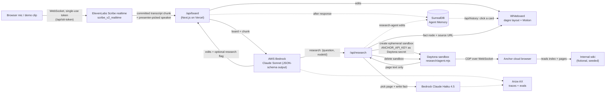

# Devpost submission: Imaginar

Paste-ready content for https://daytona-hacksprint-nyc.devpost.com/. One section per Devpost field.

**Try it:** https://imagine-lac-xi.vercel.app/board (landing page at https://imagine-lac-xi.vercel.app)

---

## Title

**Imaginar**

## Tagline

A whiteboard that listens to your team think out loud, redraws itself when you change your mind, and answers "what was our Q3 revenue?" from your private wiki inside a throwaway sandbox.

## Summary (2–3 sentences)

Imaginar listens to a group brainstorm and keeps a live idea graph in sync with where the conversation is *now*: when the team changes its mind, the old idea is superseded rather than piled on, and the card shows what it replaced. When someone asks a question that needs internal data, Claude flags it, and a research agent in an ephemeral Daytona sandbox drives an Anchor cloud browser through the team's internal wiki, then pins a short answer to the board with its source link. Every idea and fact is stored in SurrealDB Agent Memory with its timestamp, its quote, its speaker and the agent that wrote it, so clicking any card replays how that idea evolved.

## Inspiration / the problem

Brainstorms produce a mess: a whiteboard full of ideas the group already abandoned, and a list of "let me check and get back to you" questions that stall the conversation.

Voice-to-mind-map tools already exist, but they assume one speaker dictating notes, and they only ever *append*. A real group meeting doesn't work like that. Someone proposes hiring two sales reps, and someone else says "actually, let's build self-serve onboarding instead, it scales better than people." The board should now say "Self-serve onboarding", with the sales-reps idea kept as history instead of sitting next to it as an equal.

The second gap is context. The most useful questions in a meeting ("can we afford this?", "what was our Q3 revenue?") need internal data. Pasting company credentials into an AI tool that also has the open web is a non-starter, so the lookup needs a locked-down runtime that throws itself away after each question.

**Impact:** meetings end with a board that reflects the decision, not the whole debate, plus the answers to the questions that would otherwise have become follow-up emails. Each claim on the board traces back to who said it, or to the internal page it came from.

## What it does

1. **Listens.** Press *Start mic*. The browser streams audio to ElevenLabs Scribe realtime, and each committed phrase becomes a transcript chunk. Realtime STT has no speaker labels, so the presenter taps who is talking in a speaker picker.
2. **Redraws.** Each chunk, plus the current board, goes to Claude on AWS Bedrock, which returns structured board edits: `add`, `update`, `supersede`, `remove`, `link`. The board re-lays itself out with dagre and animates every card to its new position with Motion. Cards show the speaker and the quote that produced them.
3. **Supersedes instead of appending.** When the group changes its mind, Claude supersedes the old idea. The new card takes over the old one's links and shows a struck-through "was: Hire two more sales reps" trail.
4. **Answers internal questions.** If someone asks something that needs company data, Claude adds a question card and flags it for research. The card pulses "Researching in secure sandbox…" while a fresh Daytona sandbox runs a small agent. That agent drives an Anchor cloud browser to the internal wiki and reads the index and every linked page. Back outside the sandbox, Claude Haiku on Bedrock picks the page that answers the question and writes a sticky-note-length fact. The fact is pinned to the question with an "internal wiki · /finance/q3.html" link, and the sandbox is deleted.
5. **Remembers.** The board agent and the research agent both write to the same SurrealDB Agent Memory context. Click any card to open its history panel, loaded from Agent Memory: every version with its time, speaker, quote, source, and whether `board-agent` or `research-agent` added it, with superseded versions marked.
6. **Is measured.** Every Bedrock call is traced to Arize AX, and `npm run eval` replays a scripted brainstorm through the real model and scores it, uploading the result as an Arize experiment.
7. **Survives a noisy room.** The *Fallbacks* panel plays a 53-second recorded brainstorm through the same ElevenLabs path, or steps through a scripted brainstorm with no network at all.

## How we built it



ASCII version, if Devpost does not render mermaid:

```
mic ──WS──> ElevenLabs Scribe realtime ──chunk──> /api/board ──> Bedrock Claude Sonnet ──edits──> board redraws (dagre + Motion)
                                                       │                 │                              ▲
                                                       │                 └─ research flag ──> /api/research   click card: /api/history
                                                       ▼                                         │             │
                                            SurrealDB Agent Memory <── fact + source ────────────┤             │
                                                       └─────────────────────────────────────────┼─────────────┘
                                                                                                 ▼
                     Daytona ephemeral sandbox (Anchor key = secret placeholder) ──CDP──> Anchor browser ──> internal wiki
                     page text leaves ──> Bedrock Claude Haiku picks page + writes fact (outside the sandbox); sandbox deleted

                     every Bedrock call + research span ──> Arize AX (OpenInference)
```

**Board model.** The source of truth is a small graph (`lib/board.ts`), not pixels. Claude never draws; it returns edits that `applyEdits` validates and applies. Edits that reference unknown or stale ids are skipped instead of crashing the board, because they come from an LLM. Layout is pure (`lib/layout.ts`): dagre computes positions, and every edge is a 4-point cubic so Motion can interpolate the SVG path between layouts. That gives the board its smooth "realign" when an idea is replaced.

**Brain.** `lib/brain.ts` calls `us.anthropic.claude-sonnet-5-5` on Bedrock (us-west-2) with a JSON-schema output format, low effort and thinking off, because latency matters more than depth here. The system prompt states the supersede-vs-update-vs-add rules and includes the scripted demo brainstorm as few-shot examples. Chunks are processed one at a time on the client, so each call sees the board the previous call produced. The output is validated again server-side at the trust boundary.

**Secure research.** `app/api/research/route.ts` creates one ephemeral Daytona sandbox per question. The Anchor API key is registered once as a Daytona secret scoped to `api.anchorbrowser.io`. The sandbox only ever sees a placeholder, and Daytona's egress proxy substitutes the real key only on requests to that host. The question and wiki URL go in as environment variables, never interpolated into the shell command. Inside, `research/agent.mjs` (zero dependencies, Node 22+) opens an Anchor browser session, drives it over a minimal hand-written CDP client, reads the wiki index and the text of every linked page, and prints them as one JSON line along with a keyword-match fallback answer. The route then asks Claude Haiku 4.5 on Bedrock (`lib/research.ts`), outside the sandbox, to pick the page and write a fact of at most 10 words. No AWS keys go into the sandbox. The source URL is always the `href` of a page the browser actually read, never a URL the model wrote. If the Haiku call fails, the keyword match is used instead. The sandbox is deleted in a `finally`.

**Memory.** `lib/memory.ts` maps board edits to SurrealDB Agent Memory triples. Each node is a `concept` entity, its label is a versioned attribute (a label `update` closes the old value natively), and an idea `supersede` writes an explicit `superseded_by` relation with `valid_from` set to the time of the edit. Both agents write to the same scope with an `added_by` tag. Writes happen in Next's `after()`, so the board never waits on memory. `app/components/HistoryPanel.tsx` reads `/api/history` back, so the history panel shows memory, not browser state.

**Observability and evals.** `lib/otel.ts` registers an OpenTelemetry exporter to Arize AX (project `brainstorm-board`), and `lib/tracing.ts` patches the Anthropic SDK with OpenInference instrumentation, so every Bedrock call (Sonnet board edits and Haiku research) is an LLM span with token counts. A `board-edits` chain span records the chunk, speaker, edit ops and research flag, and a `research` tool span records the question, fact, source, status and duration. `scripts/eval-board.ts` (`npm run eval`) replays the scripted brainstorm through the real Bedrock call, teacher-forced so one bad step doesn't cascade. It scores each step for missed ideas, invented ideas, supersede correctness and research-flag correctness, then uploads a dataset, an experiment and per-run scores to Arize.

**Ears.** `/api/stt-token` mints a single-use ElevenLabs realtime token, so the browser never sees the API key. `lib/scribe.ts` uses VAD commits, so live mic audio and a replayed recording produce the same chunks.

### Sponsor tools

| Tool | How we use it | Where |
|---|---|---|
| **Daytona** | One **ephemeral sandbox per research question**. The research agent runs there, and the Anchor API key is a **Daytona secret**: the sandbox sees a placeholder, and the real key is substituted only on egress to `api.anchorbrowser.io`. Inputs pass as env vars, only the wiki page text leaves, and the sandbox is deleted in `finally`. A second, long-lived public sandbox hosts the fake internal wiki. | `app/api/research/route.ts`, `research/agent.mjs`, `wiki/launch.mts` |
| **Anchor Browser** | The research agent creates an Anchor cloud browser session from inside the Daytona sandbox, drives it over CDP to the wiki index, and reads every linked page from inside the browser. The session is deleted afterwards. | `research/agent.mjs` |
| **ElevenLabs** | Scribe realtime (`scribe_v2_realtime`) over a browser WebSocket with VAD commits. A server route mints single-use tokens, and the same path replays the recorded demo clip as the noisy-room fallback. | `app/api/stt-token/route.ts`, `lib/scribe.ts`, `lib/useTranscript.ts` |
| **AWS Bedrock** | Claude Sonnet (`us.anthropic.claude-sonnet-5-5`) turns *board + transcript chunk* into JSON-schema-constrained board edits and decides when a spoken question needs research. Claude Haiku 4.5 picks the wiki page and writes the fact, outside the sandbox. | `lib/brain.ts`, `lib/research.ts`, `app/api/board/route.ts` |
| **SurrealDB Agent Memory** | Shared memory for the board agent and the research agent. Ideas and facts are typed, timestamped entities with provenance (quote and speaker, or source URL) and an `added_by` agent tag. Supersedes are `superseded_by` relations with `valid_from`, and label edits use native attribute supersession. Clicking a card opens its version history straight from memory. | `lib/memory.ts`, `app/api/history/route.ts`, `app/components/HistoryPanel.tsx` |
| **Arize AX** | OpenInference tracing of every Bedrock call, plus `board-edits` and `research` spans with the chunk, speaker, edits, research flag, fact and source, in project `brainstorm-board`. `npm run eval` scores missed ideas, invented ideas, supersede correctness and research-flag correctness, and uploads them as an Arize experiment. | `lib/otel.ts`, `lib/tracing.ts`, `instrumentation.ts`, `scripts/eval-board.ts` |
| **Vercel** | Next.js 16 App Router app: the whiteboard UI and every API route (STT token, board brain, research, memory, history). `after()` keeps memory writes and trace flushes off the response path. Deployed through Vercel's Git integration at https://imagine-lac-xi.vercel.app. | `app/` |

## Challenges we ran into

- **No speaker labels in realtime STT.** Scribe's realtime mode has no diarization, so the presenter taps the current speaker's name in a speaker picker and each chunk is tagged with that name.
- **Per-sandbox network allowlists.** We wrote the sandbox to allow only Anchor's API and CDP hosts, but our Daytona tier rejects per-sandbox allowlists. The route falls back to a normal sandbox, so **sandbox egress is not domain-restricted in this demo**. The secret placeholder still only resolves for `api.anchorbrowser.io`, and the fallback is marked in code to be removed on a higher tier.
- **Getting the secret through Node.** Daytona substitutes secrets in its egress HTTPS proxy, and Node's built-in `fetch` ignores proxy env vars unless `NODE_USE_ENV_PROXY=1` is set. Without it, requests skip the proxy and carry the placeholder instead of the key.
- **Keeping the model out of the sandbox.** We wanted an LLM to choose the page, but not to put AWS keys in the sandbox. The sandbox now returns page text only, the model runs in the route, and the source URL is always one the browser actually read, so the model can't invent a citation.
- **Anchor rate limits.** Anchor rate-limits back-to-back browser session creation, so research questions asked in quick succession can fail. We space questions out in the demo.
- **Supersede vs. append.** A model's default is to add the new idea next to the old one. The system prompt gives explicit supersede, update and remove rules and uses the scripted demo as few-shot examples, and `applyEdits` makes the new idea inherit the old one's edges so the graph stays connected.
- **Latency.** Claude runs with thinking off and low effort, memory writes and trace flushes run after the response, and research runs alongside later chunks, so the board keeps moving while a sandbox is working.

## Accomplishments that we're proud of

- The full loop runs live in production: speech in, board redraws, and an internal question gets answered from a sandbox and pinned with its source.
- Credentials never enter the sandbox in usable form, AWS keys never enter it at all, and only page text leaves it.
- Ideas change, not just accumulate. The board shows what each card replaced, and one click shows the full timestamped chain from memory, including which agent wrote each version.
- We measure faithfulness. The eval runs the real model and scores missed ideas, invented ideas, supersedes and research flags. Any score on `demoScript` is inflated, because `demoScript` is also the prompt's few-shot set. So we also score a held-out brainstorm (`clipScript`, the one in the demo clip): 6 of 7 steps pass, 0 of 5 ideas missed, 1 invented (an extra "Can we afford all this?" question), supersede and research flags 100%.
- Small, tested core: pure board, brain-validation, memory-mapping and research-pick logic with `node --test` tests, plus a self-test for the research agent's fallback picker, all run in CI with lint and build.

## What we learned

- The board is easier to reason about as a graph that the model edits through a constrained schema than as anything the model draws.
- Daytona secrets plus ephemeral sandboxes are a clean way to hand an agent a credential it can use but not read. Splitting "browse in the sandbox" from "think outside it" keeps the sandbox free of model keys too.
- Hosted memory with native supersession beats rolling our own versioning: "what did we believe at 2:10?" is a query, not a feature we had to build.
- An eval that reuses your few-shot examples flatters you. You need a held-out script.

## What's next

- Real authentication to internal sources through Anchor identities. The demo wiki is public and fictional, so no login was needed.
- Per-sandbox egress allowlists on a Daytona tier that supports them.
- Real speaker diarization once realtime STT supports it, so the speaker picker can go away.
- Track the held-out `clipScript` score in Arize over prompt changes, and grow the held-out set.
- A replay slider over the whole board, driven by Agent Memory, showing the board as it stood at any moment of the meeting.
- More sources than one wiki.

## Built with

`nextjs` `react` `typescript` `tailwindcss` `vercel` `aws-bedrock` `claude` `elevenlabs` `daytona` `anchor-browser` `surrealdb` `arize` `opentelemetry` `openinference` `dagre` `motion`

## Honesty notes (for Q&A, not for the page)

- The "internal wiki" is fictional seeded data (Acme), served from a **public** Daytona preview URL with no login.
- Sandbox network egress is **not** restricted per sandbox (a tier limitation; see the `shortcut:` comment in `app/api/research/route.ts`). What we do claim: an ephemeral sandbox per job, the key as a secret placeholder substituted only for `api.anchorbrowser.io`, only page text leaving, and the sandbox deleted.
- Speakers come from the presenter's picker, not from the STT. When the demo clip plays, every line is tagged with whichever speaker is selected.
- The demo clip voices are macOS text-to-speech (`scripts/make-demo-clip.sh`), not real people.
- `demoScript` is also the few-shot set, so its 6/6 is inflated. The held-out `clipScript` score is the honest one: 6 of 7 steps pass, 0 of 5 ideas missed, 1 invented (an extra "Can we afford all this?" question), supersede and research flags 100% (`npm run eval -- clip`).
- Anchor rate-limits back-to-back session creation, so research questions need spacing.
