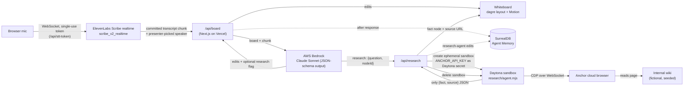

# Devpost submission: Live Brainstorm Whiteboard

Paste-ready content for https://daytona-hacksprint-nyc.devpost.com/. One section per Devpost field.

---

## Title

**Live Brainstorm Whiteboard**

## Tagline

A whiteboard that listens to your team think out loud, redraws itself when you change your mind, and answers "how does our Q3 look?" from your private wiki inside a throwaway sandbox.

## Summary (2–3 sentences)

Live Brainstorm Whiteboard listens to a group brainstorm and keeps a live idea graph in sync with where the conversation is *now*: when the team changes its mind, the old idea is superseded rather than piled on, and the board shows what it replaced. When someone asks a question that needs internal data, Claude flags it, and a research agent in an ephemeral Daytona sandbox drives an Anchor cloud browser to the team's internal wiki, then pins the answer to the board with its source link. Every idea and fact is stored in SurrealDB Agent Memory with its timestamp, the quote that produced it, and which agent wrote it, so you can replay how an idea evolved.

## Inspiration / the problem

Brainstorms produce a mess: a whiteboard full of ideas the group already abandoned, and a list of "let me check and get back to you" questions that stall the conversation.

Voice-to-mind-map tools already exist, but they assume one speaker dictating notes, and they only ever *append*. A real group meeting doesn't work like that. Someone proposes a free tier, someone else says "free forever is too expensive, make it a 30-day trial," and the board should now say "30-day trial", with the free tier still visible as history instead of sitting next to it as an equal.

The second gap is context. The most useful questions in a meeting ("can we afford that?", "how does Q3 look?") need internal data. Pasting company credentials into an AI tool that also has the open web is a non-starter, so the lookup needs a locked-down runtime that throws itself away after each question.

**Impact:** meetings end with a board that reflects the decision, not the whole debate, plus the answers to the questions that would otherwise have become follow-up emails. Each claim on the board traces back to who said it, or to the internal page it came from.

## What it does

1. **Listens.** Press *Start mic*. The browser streams audio to ElevenLabs Scribe realtime; each committed phrase becomes a transcript chunk.
2. **Redraws.** Each chunk, plus the current board, goes to Claude on AWS Bedrock, which returns structured board edits: `add`, `update`, `supersede`, `remove`, `link`. The board re-lays itself out with dagre and animates every node to its new position with Motion.
3. **Supersedes instead of appending.** When the group changes its mind, Claude supersedes the old idea. The new card takes over the old one's links and shows a struck-through "was: Free tier for small teams" trail.
4. **Answers internal questions.** If someone asks something that needs company data, Claude adds a question node and flags it for research. The card shows "Researching in secure sandbox…" while a fresh Daytona sandbox runs a small agent. That agent drives an Anchor cloud browser to the internal wiki, picks the matching page, reads the fact, and returns `{fact, source}`. The fact is pinned to the question with an "internal wiki · /finance/q3.html" link, and the sandbox is deleted.
5. **Remembers.** The board agent and the research agent both write to the same SurrealDB Agent Memory context. Labels are versioned attributes, idea replacements are `superseded_by` relations with a timestamp, and every record carries its quote and speaker, or its source URL. `GET /api/history?session=…` returns each idea's supersede chain, oldest to newest.
6. **Survives a noisy room.** A *Fallbacks* panel replays a recorded brainstorm clip through the same ElevenLabs path, or steps through a scripted brainstorm with no network at all.

## How we built it



ASCII version, if Devpost does not render mermaid:

```
mic ──WS──> ElevenLabs Scribe realtime ──chunk──> /api/board ──> Bedrock Claude ──edits──> board redraws (dagre + Motion)
                                                       │                 │
                                                       │                 └─ research flag ──> /api/research
                                                       ▼                                         │
                                            SurrealDB Agent Memory <── fact + source ────────────┤
                                                                                                 ▼
                                    Daytona ephemeral sandbox (Anchor key = secret placeholder) ──CDP──> Anchor browser ──> internal wiki
                                    only {fact, source} leaves; sandbox deleted
```

**Board model.** The source of truth is a small graph (`lib/board.ts`), not pixels. Claude never draws; it returns edits that `applyEdits` validates and applies. Edits that reference unknown or stale ids are skipped instead of crashing the board, because they come from an LLM. Layout is pure (`lib/layout.ts`): dagre computes positions, and every edge is a 4-point cubic so Motion can interpolate the SVG path between layouts. That gives the board its smooth "realign" when an idea is replaced.

**Brain.** `lib/brain.ts` calls `us.anthropic.claude-sonnet-5-5` on Bedrock (us-west-2) with a JSON-schema output format, low effort and thinking off, because latency matters more than depth here. The system prompt states the supersede-vs-update-vs-add rules and includes the scripted demo brainstorm as few-shot examples. Chunks are processed one at a time on the client, so each call sees the board the previous call produced. The output is validated again server-side at the trust boundary.

**Secure research.** `app/api/research/route.ts` creates one ephemeral Daytona sandbox per question. The Anchor API key is registered once as a Daytona secret scoped to `api.anchorbrowser.io`. The sandbox only ever sees a placeholder, and Daytona's egress proxy substitutes the real key only on requests to that host. The question and wiki URL go in as environment variables, never interpolated into the shell command. Inside, `research/agent.mjs` (zero dependencies, Node 22+) opens an Anchor browser session, drives it over a minimal hand-written CDP client, picks the wiki page whose keywords best match the question, and prints only `{"fact","source"}`. The route parses that one line and deletes the sandbox in a `finally`.

**Memory.** `lib/memory.ts` maps board edits to SurrealDB Agent Memory triples. Each node is a `concept` entity, its label is a versioned attribute (a label `update` closes the old value natively), and an idea `supersede` writes an explicit `superseded_by` relation with `valid_from` set to the time of the edit. Both agents write to the same scope with an `added_by` tag. Writes happen in Next's `after()`, so the board never waits on memory.

**Ears.** `/api/stt-token` mints a single-use ElevenLabs realtime token, so the browser never sees the API key. `lib/scribe.ts` uses VAD commits, so live mic audio and a replayed recording produce the same chunks.

### Sponsor tools

| Tool | How we use it | Where |
|---|---|---|
| **Daytona** | One **ephemeral sandbox per research question**: the research agent runs there, the Anchor API key is a **Daytona secret** (the sandbox sees a placeholder, and the real key is substituted only on egress to `api.anchorbrowser.io`), inputs pass as env vars, only `{fact, source}` leaves, and the sandbox is deleted in `finally`. A second, long-lived public sandbox hosts the fake internal wiki. | `app/api/research/route.ts`, `research/agent.mjs`, `wiki/launch.mts` |
| **Anchor Browser** | The research agent creates an Anchor cloud browser session from inside the Daytona sandbox, drives it over CDP to the wiki index, follows the best-matching link, and reads the `[data-fact]` element plus the page URL. The session is deleted afterwards. | `research/agent.mjs` |
| **ElevenLabs** | Scribe realtime (`scribe_v2_realtime`) over a browser WebSocket with VAD commits. A server route mints single-use tokens, and the same path replays a recorded clip as the noisy-room fallback. | `app/api/stt-token/route.ts`, `lib/scribe.ts`, `lib/useTranscript.ts` |
| **AWS Bedrock** | Claude (`us.anthropic.claude-sonnet-5-5`) turns *board + transcript chunk* into JSON-schema-constrained board edits and decides when a spoken question needs internal research. | `lib/brain.ts`, `app/api/board/route.ts` |
| **SurrealDB Agent Memory** | Shared memory for the board agent and the research agent. Ideas and facts are typed, timestamped entities with provenance (quote and speaker, or source URL). Supersedes are `superseded_by` relations with `valid_from`, and label edits use native attribute supersession. `/api/history` replays each idea's chain. | `lib/memory.ts`, `app/api/history/route.ts`, `app/api/memory/route.ts` |
| **Arize AX** | <!-- verify after Arize PR merges --> OpenInference tracing of the Bedrock Claude call and the research route, plus evals against the scripted brainstorm that score missed ideas, invented ideas and wrong or missing supersedes. | `lib/tracing.ts`, `lib/otel.ts` (Arize PR) |
| **Vercel** | Next.js 16 App Router app: the whiteboard UI and every API route (STT token, board brain, research, memory, history). `after()` keeps memory writes off the response path. Deployed through Vercel's Git integration. | `app/` |

## Challenges we ran into

- **No speaker labels in realtime STT.** Scribe's realtime mode has no diarization, so the presenter taps the current speaker's name in a speaker picker and each chunk is tagged with that name.
- **Per-sandbox network allowlists.** We wrote the sandbox to allow only Anchor's API and CDP hosts, but our Daytona tier rejects per-sandbox allowlists. The route falls back to a normal sandbox, so **sandbox egress is not domain-restricted in this demo**. The secret placeholder still only resolves for `api.anchorbrowser.io`, and the fallback is marked in code to be removed on a higher tier.
- **Getting the secret through Node.** Daytona substitutes secrets in its egress HTTPS proxy, and Node's built-in `fetch` ignores proxy env vars unless `NODE_USE_ENV_PROXY=1` is set. Without it, requests skip the proxy and carry the placeholder instead of the key.
- **Supersede vs. append.** A model's default is to add the new idea next to the old one. The system prompt gives explicit supersede, update and remove rules and uses the scripted demo as few-shot examples, and `applyEdits` makes the new idea inherit the old one's edges so the graph stays connected.
- **Latency.** Claude runs with thinking off and low effort, memory writes run after the response, and research runs alongside later chunks, so the board keeps moving while a sandbox is working.

## Accomplishments that we're proud of

- The full loop runs live: speech in, board redraws, and an internal question gets answered from a sandbox and pinned with its source.
- Credentials never enter the sandbox in usable form, and nothing but one JSON line leaves it.
- Ideas change, not just accumulate: the board shows what each card replaced, and memory keeps the timestamped chain.
- Small, tested core: pure board, layout, brain-validation and memory-mapping logic with `node --test` tests, plus a self-test for the research agent's page picker, all run in CI with lint and build.

## What we learned

- The board is easier to reason about as a graph that the model edits through a constrained schema than as anything the model draws.
- Daytona secrets plus ephemeral sandboxes are a clean way to hand an agent a credential it can use but not read.
- Hosted memory with native supersession beats rolling our own versioning: "what did we believe at 2:10?" is a query, not a feature we had to build.

## What's next

- Real authentication to internal sources through Anchor identities. The demo wiki is public and fictional, so no login was needed.
- Per-sandbox egress allowlists on a Daytona tier that supports them.
- Real speaker diarization once realtime STT supports it, so the speaker picker can go away.
- A replay slider in the UI driven by `/api/history`, showing the board as it stood at any moment of the meeting.
- An LLM-based page picker in the research agent instead of keyword overlap, and more sources than one wiki.

## Built with

`nextjs` `react` `typescript` `tailwindcss` `vercel` `aws-bedrock` `claude` `elevenlabs` `daytona` `anchor-browser` `surrealdb` `arize` `opentelemetry` `dagre` `motion`

## Honesty notes (for Q&A, not for the page)

- The "internal wiki" is fictional seeded data (Acme), served from a **public** Daytona preview URL with no login.
- Sandbox network egress is **not** restricted per sandbox (tier limitation, see the `shortcut:` comment in `app/api/research/route.ts`). What we do claim: an ephemeral sandbox per job, the key as a secret placeholder substituted only for `api.anchorbrowser.io`, only `{fact, source}` leaving, and the sandbox deleted.
- Speakers come from the presenter's picker, not from the STT.
- The research agent chooses a wiki page by keyword overlap with the question, not with an LLM.
- The "was:" trail on the board comes from in-browser board state. Memory holds the same history and is readable through `/api/history`, but the UI does not read it back yet.
